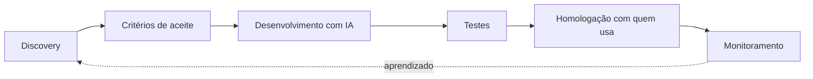

# Olá, eu sou a Jessica Lima 👋

**Product Owner que une negócio, tecnologia e qualidade.** 
PO técnica: escrevo os critérios, testo, homologo com quem usa e monitoro depois da entrega.

  

<a href="https://jessica-lima.vercel.app">
  <picture>
    <source media="(prefers-color-scheme: dark)" srcset="https://raw.githubusercontent.com/jessicaccl/portfolio/main/docs/screenshots/02-topo-escuro.webp" />
    
  </picture>
</a>

Clique na imagem para abrir o portfólio. Ela troca de tema junto com o seu GitHub.

---

## Sobre mim

Foram 10 anos à frente de um negócio próprio no varejo de moda, cuidando de vendas, marketing e gestão. Daí veio o olhar de dono: entender o cliente antes de pensar na solução.

Fiz residência em Desenvolvimento FullStack (Java, C# e .NET, APIs REST, React, TypeScript e React Native) e levei para a tecnologia essa visão de negócio.

Hoje trabalho, com o time, em três frentes numa locadora de motos: **produto**, **desenvolvimento de software com IA** e **qualidade** do ERP, com integrações financeiras e agentes de IA no atendimento.

## Projetos

| Projeto | O que é | Links |
|---|---|---|
| **CRM Pro** | Funil em Kanban, painel de resultados e ficha do cliente. Recebe leads reais por webhook. | [Demo](https://crm-pro-jessica.vercel.app) · [Código](https://github.com/jessicaccl/crm-frontend) |
| **Assina+** | Gestão de assinaturas com cobranças recorrentes e painel de provisões. 89 testes automatizados. | [Front](https://github.com/jessicaccl/gerenciamento-de-assinaturas-frontend) · [API](https://github.com/jessicaccl/gerenciamento-de-assinaturas-backend) |
| **Loja Irmãs Amare** | Loja online do meu negócio, no ar. | [Loja](https://amare-omega.vercel.app) |
| **Portfólio** | Construído como produto: PRD, user stories, critérios de aceite e qualidade no CI. | [Site](https://jessica-lima.vercel.app) · [Código](https://github.com/jessicaccl/portfolio) |

<b>Como eu trabalho</b> (clique para abrir)

 

Cada entrega começa por entender o problema com quem vive ele e só termina quando está sendo usada e acompanhada.

<b>Ferramentas do dia a dia</b> (clique para abrir)

 

- **Produto:** discovery, PRD, user stories, critérios de aceite, roadmap
- **Qualidade:** Vitest, Playwright, axe-core, Lighthouse, homologação com usuários
- **Desenvolvimento:** React, TypeScript, Java (Spring Boot), C# (.NET), PostgreSQL, APIs REST
- **IA:** Claude Code, Lovable, agentes de IA no WhatsApp

 
Quer ver os cases completos? <a href="https://jessica-lima.vercel.app/#cases">Abra a esteira de cases no portfólio</a>.

